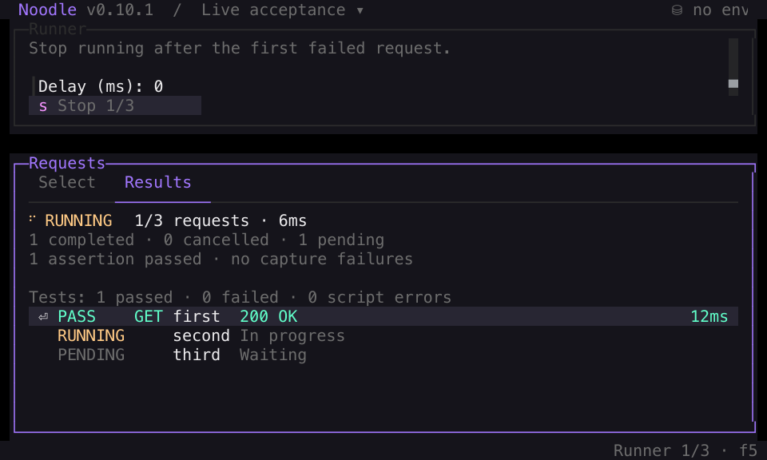

Run a group of saved requests without leaving the terminal interface. You need
an initialized collection with requests, and an environment if they use variables.
Save pending request and folder changes before starting.

## Configure a run

1. Press **F5**, or open **Ctrl+P** and choose **Run Collection**. F5 resumes
   live results or the collection's latest retained run when available.
2. Select the requests or folders to include. A folder includes its descendants.
3. Choose the environment. Add **Include** or **Exclude** tags to narrow the selection.
4. Enable **Fail-fast** if later requests should stop after a failure. Set a delay
   in milliseconds if the API needs time between requests.
5. Optionally enter a CSV or JSON **Data file** path and check the iteration count.
6. Choose **Run** to start. Inspect the ordered results as they arrive.

A folder's context menu opens the Runner scoped to that folder. Selection uses
collection order. Within each directory, folders come first, ordered by their
`meta.seq` when set, then by name. Requests follow, ordered by their display name.
For a sequence such as create then fetch, prefix request names with `01` and `02`
to make the intended order explicit. See [Collection YAML](/docs/reference/collection-format/).

## Filter with tags

Request tags and tags inherited from non-root folders form dynamic suites.
Include tags must all match; any matching Exclude tag removes a request.
Exclusion wins. Tags are case-sensitive. A selection with no matching requests
cannot run. See [CLI tag examples](/docs/guides/automation/#build-dynamic-suites-with-tags)
for the same selection rules in scripts.

## Inspect results

Results appear as each request finishes. Rows show pending, running, passed,
failed, skipped, or cancelled executions, grouped by iteration when using data.
Select a completed row and press **Enter**, or click it, to inspect the response,
script, capture, assertion, and test outcomes while later requests continue.
Details include **Console** when logs are available. Tab and scrolling remain
available during execution.

Before HTTP, the TUI Runner checks the syntax of applicable scripts and tests
for all selected requests without executing them during validation. With
fail-fast enabled, later selected requests are recorded as skipped after all
available diagnostics for the failed request finish.



## Stop a run or return later

Press **s** in the Runner or its completed-result detail overlay, click **Stop**,
or focus the Stop action and press **Enter** or **Space**. The command palette
also offers **Stop Collection Run**. The action shows **Stopping** until shared
cancellation and cookie cleanup finish.

Completed results and finished response diagnostics remain available. Cancelled
executions stay separate from failures, and selected requests that never start
are recorded as skipped because of cancellation. Stopping cannot undo HTTP
effects already sent.

Press **Escape** to leave the Runner while it continues. Read-only browsing,
view navigation, and appearance controls remain available. Press **F5** to
return to the current workspace's live, partial, or final results.

Request and folder edits, additional sends, collection switches and reloads,
and environment, cookie, or transport configuration changes stay locked until
the run and cleanup finish. Afterward, use **Left** from the results list to
return to configuration. Editing options does not change the configuration
shown with retained results.

## Share values within a run

[Captures](/docs/guides/captures/) and script writes can pass values to later
requests in the same run. Each new run starts with a fresh scope. The Runner
keeps those values transient even when a request declares persistence.

## Keep results during the app session

Each collection keeps its latest settled run in memory until you exit Noodle.
Reload the collection, switch to another collection and back, or browse other
views, then press **F5** to return. The result keeps its original request labels,
executed configuration, and selected request/iteration even after you edit the
next run's options or change collection files.

A later settled run replaces the snapshot, including failed or cancelled runs.
A configuration or preflight failure leaves the previous result available.
Runner snapshots do not create files, edit request declarations, or write
Timeline history, and they disappear when the app exits.

Retained text body previews stop at 10,000 UTF-8 bytes and show a truncation
notice. Diagnostic limits may omit details; an explicit notice appears while
failure summaries and source origins remain available. Binary responses retain
metadata only, without a body that can be downloaded from the snapshot.

## Open the source of a result

After the run and cleanup finish, open a completed result's details and press
**o**, or choose **Open source**. From **Results**, this opens the source of the
selected script, test, assertion, or capture. Inherited scripts and tests open
the owning folder or collection script phase. An aggregate test result with
multiple origins offers a searchable picker. From other detail tabs, the action
opens the request.

External sources open their declaration; use the existing **Ctrl+Alt+X** action
to open the validated JavaScript file in your configured editor. If a source was
renamed or deleted, Noodle warns and keeps the result available. Press **F5** to
return to the retained result selection. Source navigation is available after
cleanup, while completed results remain inspectable during active runs.

## Run the same collection from the CLI

```bash
noodle collection run ./my-api --env development
```

Interrupt CLI collection runs with **Ctrl+C** to keep partial results and exit
`130`. See [cancellation results](/docs/guides/automation/#interrupt-a-collection-run).

Use [CLI automation and CI](/docs/guides/automation/) for targets, tags, JSON
output, exit statuses, and GitHub Actions. Add [response assertions](/docs/guides/assertions/)
to make a run check behavior rather than just send HTTP requests.


## CSV and JSON iteration data

```bash
noodle collection run ./my-api --data ./data/users.csv
noodle collection run ./my-api users/ --data ./data/users.json --tag smoke --delay 100 --fail-fast --json
```

`--data` is optional and independent of the `--json` output flag. In F5, enter
the optional **Data file** path, check the iteration count, and select **Run**.
Relative CLI paths start at the current directory; relative F5 paths start at
the collection root. Both accept absolute paths. The F5 field also completes
paths and accepts `@/` for your home directory. F5 revalidates at run start.
The data-file path used by a settled run stays with its session snapshot;
the dataset contents are not retained.

CSV uses a header row as variable names and keeps cells as strings, including
quoted commas and multiline fields; a UTF-8 BOM is accepted. JSON requires a
non-empty array of objects and preserves JSON value types:

```json
[{ "user_id": 1, "active": true }, { "user_id": 2, "active": false }]
```

The entire file is validated before requests are sent. Empty files, invalid or
unsafe variable names, duplicate CSV headers, and inconsistent CSV rows fail.
Names use letters, digits, or underscores. Limits are 5 MiB per file, 1,000
rows, and 10,000 selected request executions. Rows must fit the existing
256 KiB/depth-32 bridge limits, including the iteration wrapper.

Each row runs every selected request in collection order. Its variables
override environment values for `$name` substitution and `noodle.run.get`;
successful captures and scripts can replace them during that iteration.
`noodle.env.get` continues to read the original environment snapshot.
`noodle.iteration` is deeply read-only `{ index, count, data }`, with zero-based
`index` and the original row in `data`. It is `null` without data and is shared
with child requests. JavaScript objects in `data` retain their JSON types.

Each row starts with fresh variables and an in-memory copy of the same initial
cookie jar. Cookies change within that row only and are never persisted.
Fail-fast skips every remaining request and row. Delay applies between all
consecutive executions, including row boundaries. Results, skips, and details
carry zero-based `iteration`; the collection result adds `iterations`. F5 groups
results by iteration and counts progress across all executions. Human labels
show iteration numbers starting at one. Datasets themselves are not included
in results or history.

Exit codes are `0` for success, `1` for execution/response validation failure,
`2` for configuration or invalid data, and `130` for collection cancellation.
Without `--data`, each selected request runs once.
